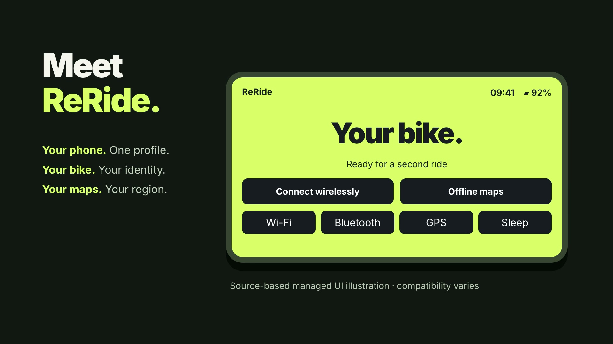

<div align="center">


# ReRide

### Your old Android. Your bike's new head unit.

An app-first toolkit for **Android Auto**, **offline navigation** and a display that feels like your bike.


<a href="media/reride-demo.mp4"></a>

<sub>▶ Click to watch the 24-second film, with sound.</sub>

[Get started](#-get-started) · [Device profiles](profiles/devices) · [Safety](docs/security.md) · [Contribute](CONTRIBUTING.md)

</div>

## 🏍️ A second ride, not another gadget

- **Your phone + bike.** The agent asks for the model, brand and map region.
- **Connected or offline.** Open Headunit projection, or a compatible navigator with downloaded maps.
- **Made yours.** Branded managed-UI source, local PIN, radio and sleep controls.
- **Model-aware.** Identity checks, verified backups and firmware review gates.

## 🚀 Get started

Python 3.11+ · Git · ADB for inspection

```sh
git clone https://github.com/geekyshubham/reride-android-auto.git
cd reride-android-auto
python3 reride.py init
```

**With an agent:** open this folder and say *“Turn my old phone into a bike head unit.”* [AGENTS.md](AGENTS.md) guides intake and testing.

[Setup & build](docs/workflow.md) · [LYF origin](docs/lyf-case-study.md) · [Firmware adapters](docs/firmware-adapters.md) · [Verification](docs/verification.md)

> **No universal ROM.** Firmware needs an audited adapter for the exact model. Managed source is experimental/API22. Debloating cannot restore missing OS security updates.

<div align="center">

Built on [Open Headunit](https://github.com/andreknieriem/open-headunit) · [AGPL-3.0](LICENSE) · [Attribution](NOTICE.md)

<sub>No vendor firmware, signing keys, proprietary APKs or manufacturer logos. ⭐ Star ReRide to help another old phone find its next ride.</sub>

</div>
